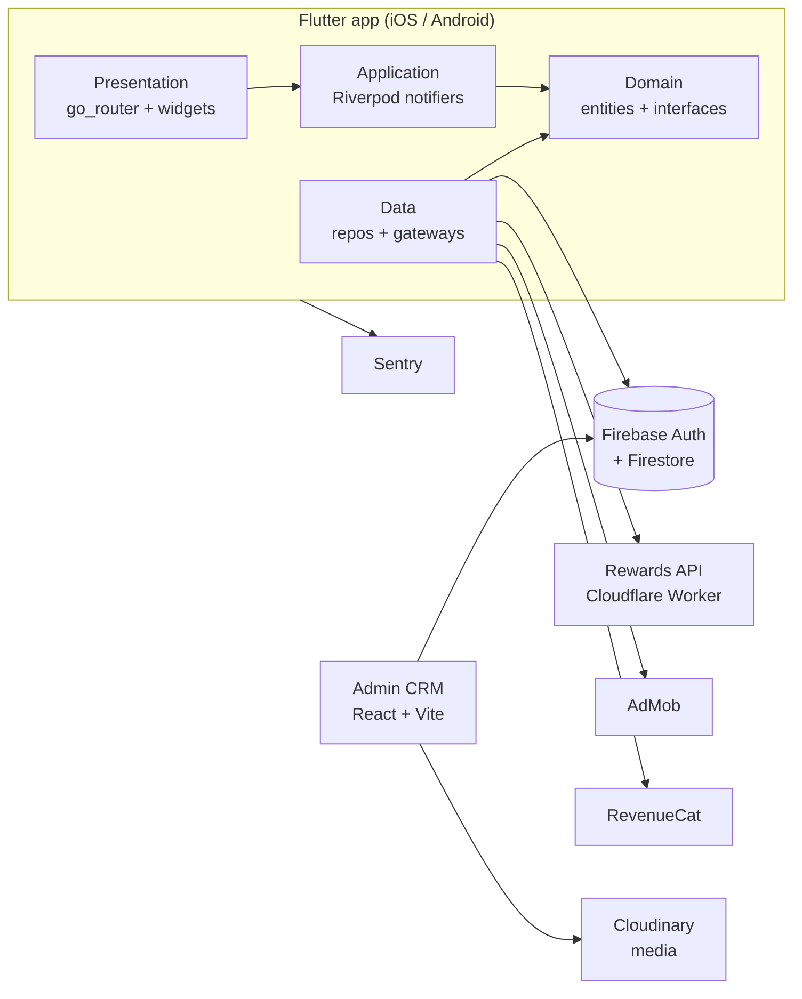

# ShortiGo

**A TikTok-style short-drama streaming app for iOS and Android: vertical episodes that play instantly on swipe, organized into series, with rewards, a coin wallet and a VIP tier, all running on a no-cost Firebase setup.**

**Web page (landing, privacy, account deletion):** https://shortigo-app.web.app


## What it does

- **Discover feed** with category tabs (For You, New, Hot, Adventure, Scary, Anime, VIP) and a series-card grid.
- **Series detail** with cover, description and the ordered episode list.
- **Shorts feed**: full-screen vertical `PageView` with a 3-controller pre-cache window, so the next video is already buffered before you swipe.
- **Episode player** (full-screen, `better_player`).
- **Auth**: email/password and Google Sign-In.
- **Rewards**: daily check-in and watch-an-ad-for-bonus.
- **Wallet**: coins (paid) and bonus (earned) balances with a transaction ledger.
- **VIP subscription** through RevenueCat; locked episodes show a subscribe CTA.
- **Studio / admin CRM** (`admin/`): a web app where approved providers upload episodes and publish series.
- **Observability**: Sentry crash reporting with route breadcrumbs, Firebase Performance traces on cold start, feed load and playback, and memory-pressure handling.

## Architecture



Key design decisions:

- **Clean-architecture-lite, four layers.** Dependencies point inward; the domain layer is pure Dart and unit-testable without mocking Firebase.
- **Swappable gateways.** `VideoSource`, `AdGateway` and `IapGateway` are interfaces, so moving video from Firestore URLs to a CDN or stream, or changing the ad/IAP provider, touches one implementation and no UI.
- **Zero-cost backend by design.** One Firebase Spark project (Auth + Firestore, no billing). Writes that must be trusted, such as rewards and permanent episode unlocks, go through a small **Cloudflare Workers Free** API (`workers/rewards-api/`) instead of paid Cloud Functions.
- **Paid backend kept ready, not deployed.** TypeScript Cloud Functions in `cloud_functions/functions/` (ad-reward verification, daily check-in, RevenueCat VIP webhook, Storage upload flow) are there for a move to a paid plan.
- **Instant playback.** Pre-caching the next videos keeps swipes free of network waits.
- **Security in rules, not the client.** Firestore rules are committed; admin rights come from an `adminUsers/{uid}` document or a custom claim, with provider-scoped catalog access and audit events for the studio.
- **Secrets at build time.** Keys are injected with `--dart-define`; defaults point at AdMob test IDs.

## Tech stack

| Layer | Choice |
| --- | --- |
| App | Flutter 3.22+ / Dart 3.4+ |
| State / DI | Riverpod 2 (codegen) |
| Routing | go_router |
| Auth / DB | Firebase Auth, Cloud Firestore |
| Local cache | drift (SQLite) |
| Video | better_player_plus |
| Ads / IAP | google_mobile_ads (AdMob), purchases_flutter (RevenueCat) |
| Trusted writes | Cloudflare Workers (rewards API) |
| Admin CRM | React + Vite + TypeScript, Cloudinary uploads |
| Monitoring | sentry_flutter, firebase_performance |

## Project structure

```
lib/                 Flutter app (core, data, domain, features, shared)
admin/               Studio / admin web CRM
workers/rewards-api/ Cloudflare Worker for trusted reward + unlock writes
cloud_functions/     Optional paid-plan backend (TypeScript)
hosting/public/      Web pages (landing, privacy, account deletion)
tools/               Firestore seeding and upload helpers
test/, integration_test/
```

## Run locally

Prerequisites: Flutter 3.22+, Xcode + CocoaPods (iOS) or Android SDK, Firebase CLI.

```bash
flutter pub get
dart run build_runner build --delete-conflicting-outputs   # freezed / json / riverpod / drift codegen
flutter run --dart-define=ENV=dev                          # defaults work without real keys
```

For a production build, pass your own keys with `--dart-define` (names: `FIREBASE_PROJECT_ID`, `SENTRY_DSN`, `ADMOB_APP_ID_IOS`, `ADMOB_APP_ID_ANDROID`, `ADMOB_REWARDED_IOS`, `ADMOB_REWARDED_ANDROID`, `RC_API_KEY_IOS`, `RC_API_KEY_ANDROID`). `dart_defines.example.json` is a template and `lib/core/env/env.dart` lists every define.

Tests: `flutter test` (unit and widget) and `flutter test integration_test`.

Firestore rules and indexes deploy with `firebase deploy --only firestore:rules,firestore:indexes`.

## Status

Version 0.1.0+3. The v1 feature set is built and the Firebase project, rules, auth providers and demo data are deployed; the app is going through store submission (latest commit: version bump for a Google Play resubmission). Release checklists and the monitoring runbook are in [`docs/`](docs/).

## Author

**Or Delevski** · https://ordelwebsite.vercel.app
